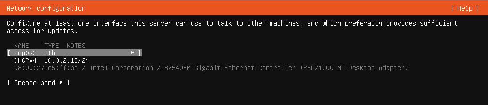
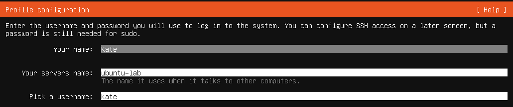
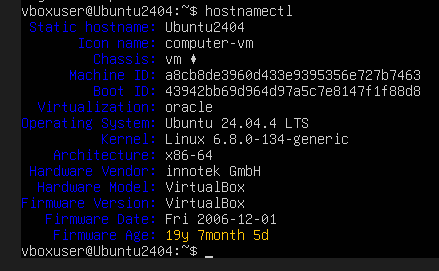

# Ubuntu Server 24.04 Administration Lab

## Overview

This project documents the installation and initial configuration of an Ubuntu Server 24.04 LTS virtual machine using Oracle VirtualBox.

The goal of this laboratory is to build a solid foundation in Linux system administration for future networking and infrastructure projects.

This lab is the first step of a larger learning path covering:

- Linux Administration
- Computer Networks
- SSH
- Network Services
- Firewall Configuration
- Storage Management
- Docker
- Web Servers
- System Troubleshooting

---

# Objectives

- Install Ubuntu Server 24.04 LTS
- Configure a virtual machine using VirtualBox
- Understand each installation option instead of using default settings
- Configure networking using NAT and DHCP
- Install OpenSSH Server
- Learn the Ubuntu Server installation process
- Document installation decisions and troubleshooting

---

# Environment

| Component | Description |
|-----------|-------------|
| Host Operating System | Windows 11 |
| Virtualization Software | Oracle VirtualBox 7.2.12 |
| Guest Operating System | Ubuntu Server 24.04.4 LTS |
| CPU | Intel Core i5 |
| RAM | 16 GB (Host) |
| VM Memory | 4096 MB |
| VM CPUs | 2 |
| Virtual Disk | 25 GB (VDI - Dynamically Allocated) |
| Network Mode | NAT |

---

# Virtual Machine Configuration

## Operating System

- Linux
- Ubuntu
- Ubuntu 24.04 LTS (64-bit)

## Hardware

- Memory: 4096 MB
- Processors: 2
- Graphics Controller: VMSVGA
- Video Memory: 16 MB

## Storage

- Virtual Disk: 25 GB
- Dynamically Allocated
- SATA Controller

## Network

Adapter 1

- Intel PRO/1000 MT Desktop
- NAT Mode

---

# Installation Decisions

## Manual Installation

The unattended installation option was intentionally disabled.

This approach allowed a better understanding of every installation step and configuration option.

---

## Language

English was selected because:

- Linux documentation is primarily written in English.
- System messages match official documentation.
- Professional environments commonly use English installations.

---

## Keyboard Layout

Portuguese (Brazil)

---

## Ubuntu Server Installation

The standard Ubuntu Server installation was selected instead of the minimized installation.

Reasons:

- Includes more administration tools.
- Better suited for learning.
- Reduces the need for installing additional packages later.

---

## Network Configuration

The Ubuntu Server network interface was configured using DHCP.

**Network interface:** `enp0s3`

**Configuration:**
- Network mode: NAT (VirtualBox)
- IP assignment: DHCP
- Assigned IP address: `10.0.2.15/24`

The following screenshot shows the network interface and the IP address assigned during installation.



### Why NAT?

NAT allows the virtual machine to access the Internet through the host computer without requiring changes to the physical network.

This configuration is suitable for an isolated learning environment.

---

# Proxy Configuration

No proxy server was configured.

---

# Package Mirror

The default Ubuntu package mirror was used.

Reasons:

- Official repositories
- Automatic mirror selection
- Reliable package updates

---

# Storage Configuration

Configuration:

- Entire virtual disk
- Logical Volume Manager (LVM)
- No encryption

## File System Layout

| Mount Point | File System |
|-------------|------------|
| /boot | ext4 |
| / | ext4 (LVM) |

Unused space was intentionally left inside the LVM Volume Group for future storage expansion exercises.

---

# Why LVM?

LVM provides:

- Flexible storage management
- Easy disk expansion
- Professional server configuration
- Future storage labs

---

## Profile Configuration

During installation, the following user profile was configured:

- Display name: Kate
- Hostname: `ubuntu-lab`
- Username: `kate`
- Administrative privileges: sudo

The user account was created to perform system administration tasks without logging in directly as root.



# SSH Configuration

OpenSSH Server was installed during setup.

Password authentication was enabled.

Reasons:

- Future remote administration labs
- SSH connectivity testing
- Learning Linux server administration

SSH key authentication will be configured in a future project.

---

# Featured Server Snaps

No optional server snaps were installed.

Reason:

Each service (Docker, Apache, Nginx, etc.) will be installed manually during future labs to better understand installation and configuration processes.


---

## Installation Verification

After completing the installation, I successfully booted Ubuntu Server and logged into the system.

I executed the `hostnamectl` command to verify the operating system and virtualization environment.

The output confirmed:

- Operating System: Ubuntu 24.04.4 LTS
- Kernel: Linux 6.8.0-134-generic
- Architecture: x86-64
- Virtualization: Oracle VirtualBox
- Hostname: Ubuntu2404



This confirmed that Ubuntu Server was successfully installed and running inside the VirtualBox virtual machine.

---

## Troubleshooting

## Installation Media

After installation completed, Ubuntu displayed:

```
Please remove the installation medium, then press ENTER.
```

The installation media was not automatically ejected.

### Resolution

- Verified VirtualBox storage configuration.
- Removed the installation ISO.
- Restarted the virtual machine.

---

## GRUB Editor

While troubleshooting the boot process, the GRUB editor was accidentally opened by pressing:

```
e
```

This editor allows temporary modifications to boot parameters.

No permanent changes were made.

The default boot entry was used afterwards.

---

# Concepts Learned

- Virtual machines
- Ubuntu Server installation
- VirtualBox configuration
- Virtual disks
- SATA controller
- NAT networking
- DHCP
- OpenSSH
- LVM
- Linux boot process
- GRUB
- Package mirrors
- Storage configuration

---

# Skills Demonstrated

- Ubuntu Server installation
- VirtualBox configuration
- Linux server deployment
- Network configuration
- DHCP
- NAT
- LVM configuration
- SSH installation
- Boot troubleshooting
- GRUB troubleshooting
- Virtual storage management
- Technical documentation

---

# Future Improvements

The following laboratories will be added to this repository:

- Initial Linux commands
- File system navigation
- Users and groups
- Linux permissions
- SSH administration
- UFW firewall
- Apache Web Server
- Docker installation
- Static IP configuration
- Network diagnostics
- LVM volume expansion
- Bash scripting

---

# References

- Ubuntu Server Documentation
- Oracle VirtualBox Documentation
- Linux Manual Pages

---

# Author

**Katia**

Computer Networks Student

Linux and Network Administration Laboratory
